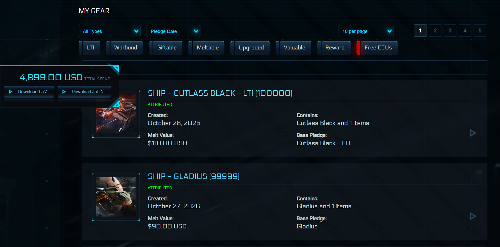
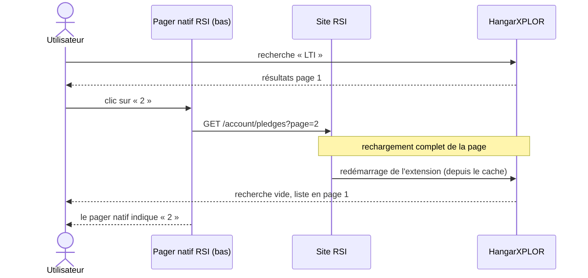
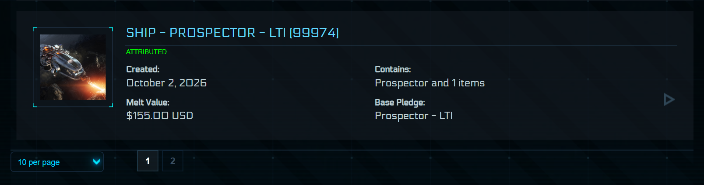
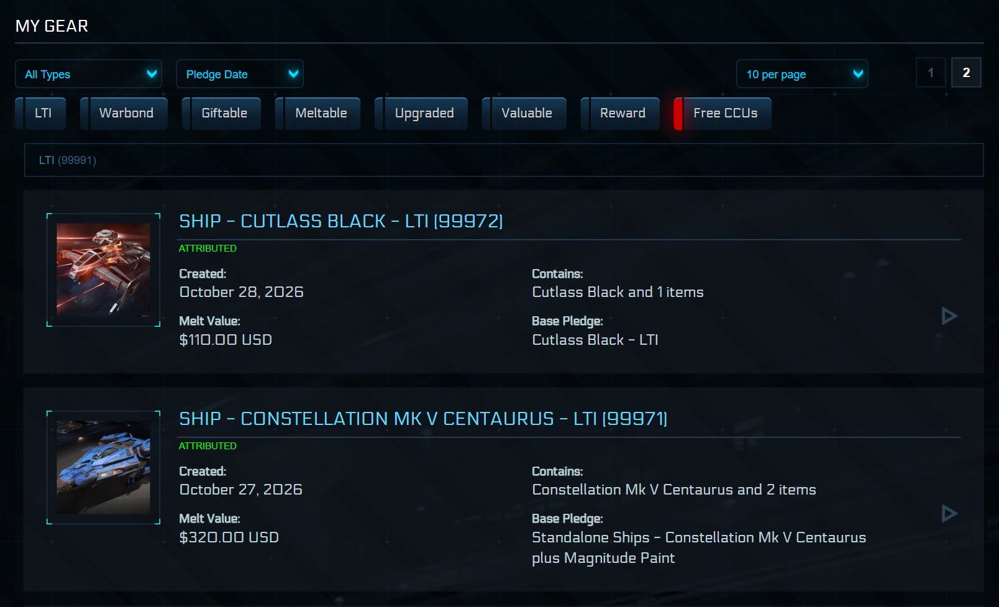
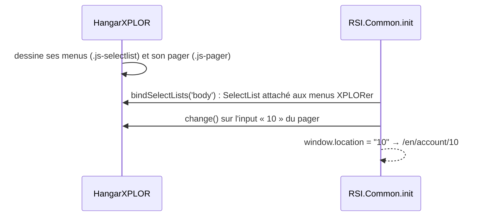
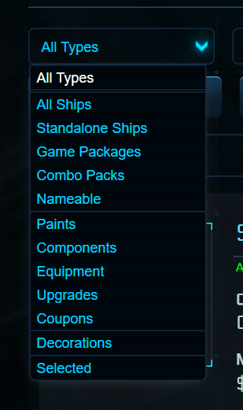
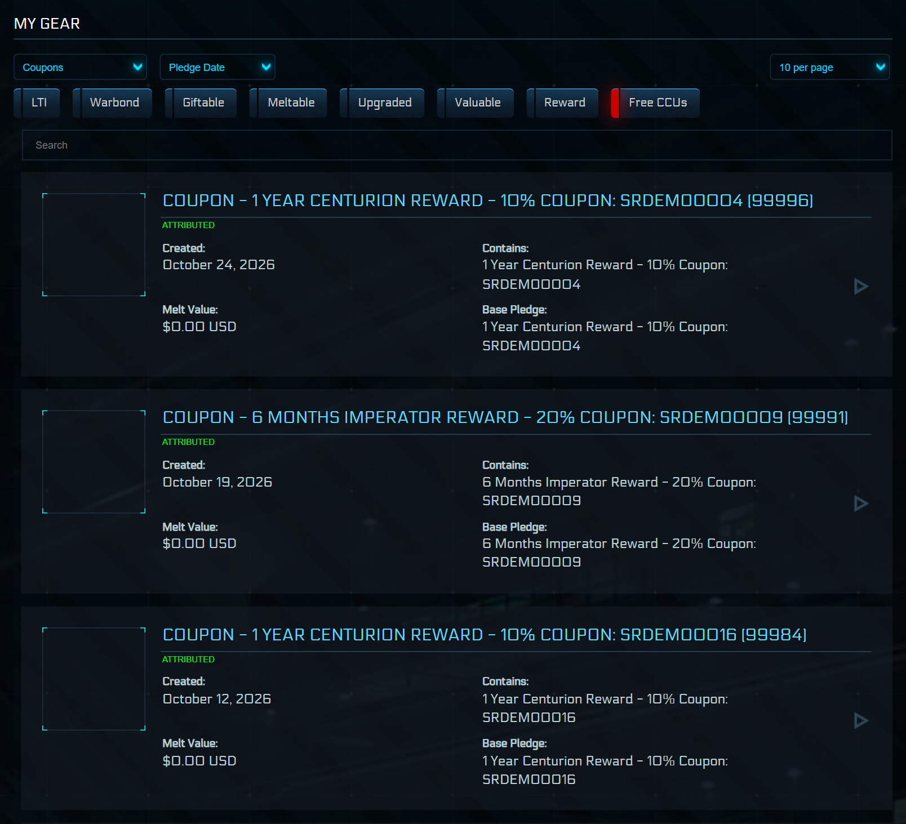
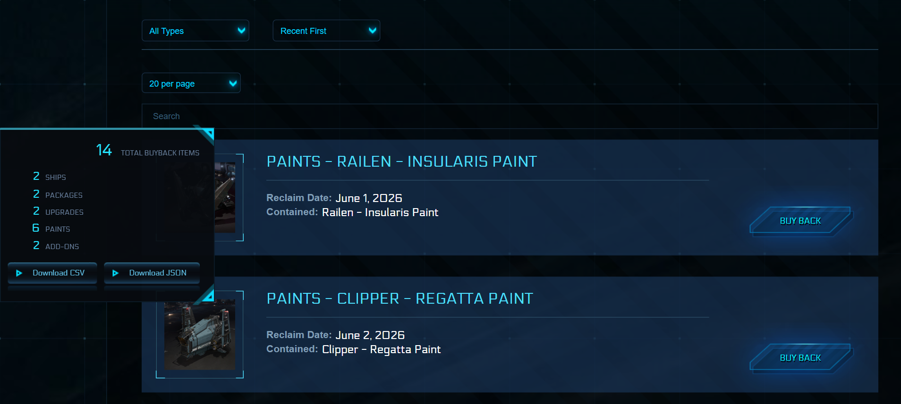
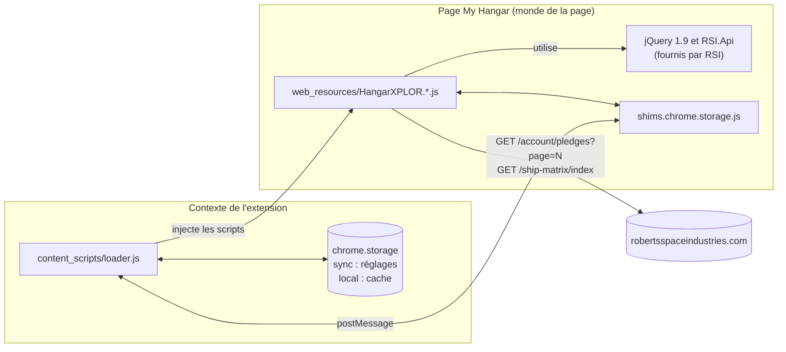
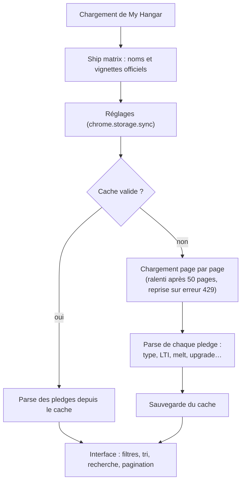

# HangarXPLOR — édition corrigée

🇬🇧 [English version](README.md)

> Extension de navigateur qui transforme la page **My Hangar** de [robertsspaceindustries.com](https://robertsspaceindustries.com/account/pledges) : tout le hangar chargé d'un coup, filtres avancés, recherche floue, valeurs de melt et exports.
> Ce dépôt est un fork maintenu de [dolkensp/HangarXPLOR](https://github.com/dolkensp/HangarXPLOR), dont l'auteur n'a plus rien publié depuis avril 2026. Il corrige ce que les changements du site RSI ont cassé (pagination, menus, identification des vaisseaux, classement des objets), reprend deux contributions restées en attente chez l'auteur (page **Buyback**, export des **CCU**) et ajoute un filtre **Coupons**.

> [!NOTE]
> **Édition d'attente.** Ce fork n'a pas vocation à remplacer le projet d'origine. Tous ses correctifs sont proposés à l'auteur (voir [Contribution](#contribution-au-projet-dorigine)). Dès qu'ils seront intégrés et publiés, revenez à l'extension officielle.



<sub>Captures réalisées avec le banc de test du dépôt et des données factices : vrai CSS et vrais scripts RSI, aucun compte réel.</sub>

---

## Sommaire

- [Fonctionnalités](#fonctionnalités)
- [Ce que cette édition corrige](#ce-que-cette-édition-corrige)
- [Ce que cette édition ajoute](#ce-que-cette-édition-ajoute)
- [Installation](#installation)
- [Utilisation](#utilisation)
- [Fonctionnement technique](#fonctionnement-technique)
- [Banc de test](#banc-de-test)
- [Organisation du dépôt](#organisation-du-dépôt)
- [Contribution au projet d'origine](#contribution-au-projet-dorigine)
- [Crédits et licence](#crédits-et-licence)

---

## Fonctionnalités

| | Fonctionnalité | Détail |
|---|---|---|
| ⚡ | **Hangar complet en une fois** | Toutes les pages du hangar sont chargées en arrière-plan, puis affichées et triées ensemble. |
| 🔎 | **Recherche floue** | Tolère les fautes de frappe (Fuse.js). Une suggestion s'affiche, **Tab** la complète. |
| 🗂️ | **Filtre par type** | Vaisseaux, packs de jeu, combos, peintures, composants, équipement, upgrades, **coupons**, décorations, sélection. Les objets que RSI laisse sans type (armures, peintures de packs…) sont classés d'après leur nom. |
| 🏷️ | **Filtres rapides** | LTI, Warbond, Giftable, Meltable, Upgraded, Valuable, Reward, Free CCUs. |
| ↕️ | **Tri** | Par date d'achat, par nom ou par valeur. |
| 📄 | **Pagination** | 10, 20, 50, 100 ou tout le hangar par page, avec un pager en haut **et en bas** de la liste. |
| 💲 | **Valeurs** | Valeur de melt et pledge d'origine sous chaque élément. Panneau flottant avec la dépense totale et le total de la sélection. |
| ✈️ | **Noms et vignettes corrigés** | Les vaisseaux upgradés (CCU) affichent leur vrai nom et l'image du vaisseau obtenu, tirés du *ship matrix* officiel. Les autres gardent l'image de RSI, peinture comprise. |
| 💾 | **Cache** | Le hangar est mis en cache dans le navigateur : les visites suivantes s'affichent instantanément. |
| 📤 | **Exports** | Vaisseaux (`shiplist.csv` / `.json`, au format [Hangar Transfer Format](https://docs.starcitizen.fans/)) et CCU (`upgradelist.csv` / `.json`), pour d'autres outils. |
| ♻️ | **Page Buyback** | Même interface sur la page des pledges rachetables : tout chargé d'un coup, filtres, tri, recherche, compteurs, exports. |

---

## Ce que cette édition corrige

Le code d'origine fonctionnait, mais **RSI a modifié sa page Hangar** et plusieurs comportements se sont cassés. Chaque correctif ci-dessous a été **vérifié sur un vrai hangar de 531 pledges** (en lecture seule), puis reproduit et testé sur le [banc de test](#banc-de-test). Tous sont aussi proposés à l'auteur d'origine (voir [Contribution](#contribution-au-projet-dorigine)).

### 1. La page 2 réaffichait la page 1 et la recherche disparaissait

**Symptôme :** avec une recherche active, cliquer sur « 2 » rechargeait toute la page. La recherche était vidée, la liste affichait les premiers pledges, et le pager indiquait pourtant « 2 ».

**Cause :** RSI affiche désormais **deux pagers natifs**, un au-dessus et un sous la liste, et leur a retiré la classe `js-pager` que l'extension utilisait pour les supprimer. Celui du haut disparaissait quand même, parce que sa zone est remplacée par les contrôles XPLORer. Celui du bas restait en place, et ses liens rechargent la page.



**Correctif :** les pagers natifs sont aussi supprimés selon leur emplacement, et un **pager XPLORer** les remplace sous la liste. Il reste synchronisé avec celui du haut et remonte en haut de la liste après un changement de page.

| Pager XPLORer sous la liste | Résultat : page 2 de la recherche, sans rechargement |
|---|---|
|  |  |

### 2. Menus qui se referment aussitôt, redirection vers une page d'erreur

**Symptôme** (ticket [#132](https://github.com/dolkensp/HangarXPLOR/issues/132) chez l'auteur d'origine) : un menu déroulant s'ouvre puis se referme immédiatement. Plus rarement, la page part vers `/en/account/10`, une page d'erreur. Le problème va et vient d'un chargement à l'autre.

**Cause :** au démarrage, le script du site (`RSI.Common.init`) :
- attache son propre widget `SelectList` à **tous** les éléments `.js-selectlist` de la page, donc les menus sont basculés deux fois ;
- redirige vers la valeur de tout `<input>` modifié dans un `.js-pager`, ce qui transforme le choix « 10 per page » en `/en/account/10`.

Les contrôles XPLORer réutilisaient ces classes. Si l'interface de l'extension est dessinée **avant** cette initialisation, ce qui arrive souvent quand le hangar vient du cache, RSI la capture.



**Correctif :** les contrôles XPLORer n'utilisent plus `js-selectlist` ni `js-pager`. Ces classes ne servent qu'aux scripts RSI, aucun style de l'extension n'en dépend.

### 3. Vaisseaux « non identifiés » ou confondus avec leur version de base

**Symptôme** (une quinzaine de tickets chez l'auteur d'origine, dont [#118](https://github.com/dolkensp/HangarXPLOR/issues/118), [#124](https://github.com/dolkensp/HangarXPLOR/issues/124), [#137](https://github.com/dolkensp/HangarXPLOR/issues/137), [#150](https://github.com/dolkensp/HangarXPLOR/issues/150)) : dans les exports, des vaisseaux sortent « *Please report this ship to the plugin developers* ». Sous Firefox, Sabre Raven devient Sabre, un Mk II devient Mk I, Golem OX devient Golem…

**Causes :**
- **Tri incohérent.** L'extension trie la liste officielle des vaisseaux du nom le plus long au plus court, pour reconnaître « Sabre Raven » avant « Sabre ». Mais sa fonction de comparaison renvoyait « égal » dans certains cas, si bien que l'ordre dépendait de l'algorithme de tri du navigateur. Chrome et Opera tombaient juste par chance ; sous Firefox, 44 vaisseaux étaient reconnus comme leur version de base.
- **Table d'export périmée.** 23 vaisseaux récents en étaient absents (Constellation Mk V Centaurus, M80, Pitbull, Starlite, Odin…). 7 autres ne pouvaient jamais être trouvés, parce que leur nom porte une espace en trop dans les données de RSI (Lynx, Nautilus, C8X Pisces Expedition…).
- **Variantes de nom.** « Mk I » était trouvé à l'intérieur de « Mk II », et des titres comme « A.T.L.S. » ou « Dragonfly Star Kitten Edition » ne correspondaient à rien.

**Correctifs :** tri stable, du plus long au plus court ; comparaison par mots entiers en ignorant la ponctuation ; table régénérée avec `scripts/refresh-ship-codes.js` (321 entrées) ; second essai sans les points et sans le suffixe « Edition ». Résultat : les 44 vaisseaux du hangar de test et 23 des 24 noms signalés dans les tickets sont reconnus, avec le même résultat quel que soit l'ordre de tri. Le dernier, « Heartseeker Mk II », n'existe pas dans les données de RSI.

### 4. Objets sans catégorie, absents des filtres

**Symptôme** ([#116](https://github.com/dolkensp/HangarXPLOR/issues/116), [#80](https://github.com/dolkensp/HangarXPLOR/issues/80)) : des sets d'armure, des combinaisons ou des packs de peintures n'apparaissent dans aucun filtre (Equipment, Paints…).

**Causes :**
- RSI liste de nombreux objets **sans aucun type** (pièces d'armure, peintures de packs, hangars, décorations) : 58 pledges du hangar de test n'étaient composés que de tels objets.
- Les filtres Equipment, Components et Decorations ne gardaient que les pledges ne contenant **qu'un seul** objet du type.

**Correctifs :** quand RSI n'en donne pas, le type est déduit du nom de l'objet (*Helmet, Core, Undersuit…* → équipement, *Paint, Livery* → peinture, *… Hangar* → hangar, *Model, Poster, Coin…* → décoration, *Repeater, Cannon…* → composant) ; et les filtres incluent les packs à plusieurs objets.

### 5. Vignettes, titres et petits défauts

- **Vignettes avec peinture remplacées par l'image générique** ([#110](https://github.com/dolkensp/HangarXPLOR/issues/110), [#99](https://github.com/dolkensp/HangarXPLOR/issues/99)) : l'image de RSI montre souvent le vaisseau avec sa peinture. Elle n'est désormais remplacée que pour les pledges upgradés (CCU), dont l'image montre encore le vaisseau d'origine.
- **Éléments effacés dans les titres** ([#147](https://github.com/dolkensp/HangarXPLOR/issues/147)) : en renommant un pledge, l'extension effaçait ce que RSI place dans le titre, comme le bouton « Upgrades » (historique des CCU) ou les tags d'accès au jeu. Seul le texte est maintenant remplacé.
- Les décorations n'étaient plus étiquetées « Hangar decoration » mais « Hangar ».
- Un seul pledge au HTML inattendu interrompait tout le chargement : il est maintenant ignoré, avec un avertissement en console.
- « *Your hangar is empty* » s'affichait quand les filtres ne laissaient rien ; le message est désormais « *No items match the current filters.* ».
- Retour en page 1 quand la recherche, le type ou un filtre rapide change.

---

## Ce que cette édition ajoute

### Filtre « Coupons »

Les coupons de récompense d'abonnement (*Centurion 10 %*, *Imperator 20 %*…) étaient déjà reconnus, mais aucun filtre ne les affichait.

| Menu des types avec « Coupons » | Filtre « Coupons » appliqué |
|---|---|
|  |  |

### Page Buyback

Reprise de la pull request [#139](https://github.com/dolkensp/HangarXPLOR/pull/139) de Drew Short, restée en attente chez l'auteur d'origine. La page des **pledges rachetables** reçoit la même interface que le hangar : tout est chargé d'un coup, avec filtres par type, tri, recherche, compteurs et exports CSV/JSON.



Confrontée au vrai HTML de RSI, la PR d'origine avait plusieurs défauts, corrigés ici :
- RSI ignore la taille de page demandée (`pagesize=50`), et la PR s'arrêtait après la première page : sur le banc, elle chargeait 10 pledges sur 14 ;
- la date était toujours vide, car RSI l'intitule désormais « *Reclaim Date* » ;
- la ligne « *No pledges available* » d'une page vide était comptée comme un pledge ;
- certains compteurs devenaient « NaN » ;
- son pager réintroduisait la classe `js-pager` piégée par RSI (voir le correctif 2) ;
- son cache restait périmé toute la journée après un rachat ;
- enfin, `src/manifest.json` n'avait pas été mis à jour : chargée depuis `src`, l'extension ne trouvait pas ses nouveaux scripts.

### Export des CCU

Reprise de la pull request [#144](https://github.com/dolkensp/HangarXPLOR/pull/144) de Myles Berueda : deux boutons **CCUs CSV** et **CCUs JSON** exportent les upgrades (vaisseau de départ, vaisseau d'arrivée, prix, date…), à côté de **Ships CSV** et **Ships JSON**. Les libellés ont été raccourcis pour que le panneau flottant reste aussi étroit qu'avant.

---

## Installation

L'extension n'est pas publiée sur un store : on la charge en **mode développeur**. Elle fonctionne dans les navigateurs basés sur Chromium (Opera, Opera GX, Chrome, Edge, Brave).

> [!IMPORTANT]
> Désactivez d'abord la version officielle « Star Citizen Hangar XPLORer » si elle est installée. Sinon, les deux versions s'exécutent en même temps sur la page.

1. Récupérez le dépôt :
   ```bash
   git clone https://github.com/Sckriva/HangarXPLOR.git
   ```
   Ou, sans git : bouton **Code → Download ZIP** sur la page GitHub, puis décompressez.
2. Ouvrez la page des extensions :
   | Navigateur | Adresse |
   |---|---|
   | Opera / Opera GX | `opera://extensions` |
   | Chrome / Brave | `chrome://extensions` |
   | Edge | `edge://extensions` |
3. Activez le **Mode développeur**.
4. Cliquez sur **Charger l'extension non empaquetée** et choisissez le dossier **`src`** du dépôt.
5. Ouvrez [My Hangar](https://robertsspaceindustries.com/account/pledges) ou [Buy Back Pledges](https://robertsspaceindustries.com/account/buy-back-pledges). Le premier chargement parcourt toutes les pages (comptez quelques secondes par page RSI), les suivants sortent du cache.

**Mise à jour :** `git pull`, puis cliquez sur **Recharger** (↻) sur la carte de l'extension.

> [!NOTE]
> Une extension chargée de cette façon ne se met pas à jour toute seule. Ses réglages et son cache sont propres à cette installation et repartent de zéro par rapport à la version du store.

<details>
<summary><b>Construire les archives par navigateur (optionnel)</b></summary>

Le script d'origine produit un `.zip` par navigateur dans `dist/` :

```bash
npm install
node build.js 3.17.192
```

Voir [docs/build.md](docs/build.md) pour Firefox, Safari et la CI.
</details>

---

## Utilisation

| Élément | Comment s'en servir |
|---|---|
| **Menu des types** | Restreint la liste à une catégorie : *All Ships*, *Upgrades*, *Coupons*… |
| **Menu de tri** | *Pledge Date* (le plus récent d'abord), *Pledge Name*, *Pledge Value*. |
| **Filtres rapides** | Trois états par clic : neutre → **inclure uniquement** (allumé) → **exclure** → neutre. *Free CCUs* exclut par défaut les upgrades à 0 $. |
| **Recherche** | Tapez quelques lettres. La suggestion grisée se complète avec **Tab**. |
| **Pagination** | Nombre d'éléments par page dans le menu ; numéros de page en haut et en bas de la liste. |
| **Sélection** | Cliquez sur un pledge pour le sélectionner. Le panneau flottant affiche le total sélectionné, et le type *Selected* n'affiche que la sélection. |
| **Panneau flottant** | Cliquez dessus pour basculer entre les montants (USD) et les compteurs (CCU, vaisseaux, packs). |
| **Exports** | *Ships CSV* / *Ships JSON* (vaisseaux, format Hangar Transfer Format) et *CCUs CSV* / *CCUs JSON* (upgrades). Si des pledges sont sélectionnés, seule la sélection est exportée. |
| **Page Buyback** | Mêmes principes : menu des types, tri (*Recent First*…), recherche, nombre par page, compteurs par catégorie et exports dans le panneau flottant. |

**Popup de l'extension** (icône dans la barre d'outils) :

| Réglage | Effet |
|---|---|
| Hide Pledge ID | Masque le numéro `(123456)` en fin de nom. |
| Hide Pledge Prefix | Masque le préfixe de type (`ship - `, `upgrade - `…). |
| Hide Nicknames | Affiche le nom du vaisseau plutôt que le surnom que vous lui avez donné. |
| Show Hangar Value | Panneau flottant en montants plutôt qu'en compteurs. |
| Clear Cache | Force un rechargement complet du hangar depuis RSI. |

---

## Fonctionnement technique

L'extension injecte ses scripts **dans la page RSI elle-même**, pour réutiliser son jQuery et son API. Ces scripts n'ont pas accès aux API du navigateur, donc un petit pont `postMessage` relaie le stockage.



**Cycle de chargement :**



Documentation détaillée de l'auteur d'origine, en anglais : [architecture](docs/architecture.md), [référence des fichiers](docs/file-reference.md), [construction](docs/build.md).

---

## Banc de test

`tools/harness/` reproduit les pages **My Hangar** et **Buy Back Pledges** en local, sans compte RSI et sans toucher au vrai hangar. Il utilise **les vrais scripts et le vrai CSS de RSI**, avec des pledges factices calqués sur le HTML réel de RSI (octobre 2026) : vaisseaux LTI, vaisseau upgradé avec son bouton « Upgrades », vaisseaux avec image de peinture, CCU, packs dont les objets n'ont pas de type, décorations, coupons, page Buyback paginée. C'est avec ce banc qu'ont été reproduits et testés les correctifs ci-dessus, et réalisées les captures de ce README.

```bash
python tools/harness/fetch_rsi.py      # une fois : télécharge les fichiers publics de RSI dans tools/harness/rsi/
python tools/harness/server.py 8791    # démarre la fausse page Hangar
```

Ouvrez ensuite <http://localhost:8791/en/account/pledges?page=1> ou <http://localhost:8791/en/account/buy-back-pledges?page=1>.

| Paramètre d'URL | Effet |
|---|---|
| `ext=src` | Dossier de l'extension à injecter, relatif à la racine du dépôt (`src` par défaut). Mémorisé par cookie, donc les liens des pagers natifs le gardent. |
| `style=plain` | Sans le CSS de RSI : plus rapide, lisible hors ligne. |
| `page=N` | Page RSI demandée : 5 pages factices de 10 pledges pour le hangar, 2 pages pour le Buyback. |

> [!NOTE]
> Les fichiers de RSI ne sont **pas** versionnés (`tools/harness/rsi/` est ignoré par git). Les noms des bundles `rsi.core` et `rsi.account` contiennent un numéro de build. Si RSI le change, `fetch_rsi.py` explique comment lui passer les nouvelles adresses.

Pour comparer avec une autre version, extrayez-la dans un dossier du dépôt avec `git worktree add .wt-release release`, puis ouvrez `?ext=.wt-release/src`.

`POST /capture?name=X` enregistre le corps de la requête dans `tools/harness/private/X.html`, un dossier ignoré par git, pour transformer une vraie page en données de test. Le navigateur peut toutefois bloquer les requêtes d'un site public vers `localhost` (protection du réseau local).

---

## Organisation du dépôt

```text
.
├── src/                      Extension (dossier à charger dans le navigateur)
│   ├── manifest.json         Manifeste MV3 complet
│   ├── content_scripts/      loader.js : injection des scripts et pont de stockage
│   ├── web_resources/        Code de l'interface (HangarXPLOR.*.js, CSS, Fuse.js, ship-codes.json)
│   ├── ui_resources/         Popup de réglages
│   └── manifest.*.json       Fragments par navigateur, utilisés par build.js
├── tools/harness/            Banc de test local (fausses pages My Hangar et Buyback)
├── scripts/                  refresh-ship-codes.js : régénère ship-codes.json depuis le ship matrix de RSI
├── docs/                     Documentation technique et captures (docs/img/)
├── build.js                  Construction des archives par navigateur
├── README.md                 Présentation (anglais)
└── README.fr.md              Présentation (français)
```

| Branche | Rôle |
|---|---|
| **`main`** | Branche de travail : code d'origine + correctifs + PR #139 et #144 reprises + filtre Coupons + banc de test. |
| `release` | Copie exacte de la branche `release` de l'auteur d'origine, jamais modifiée ici. |
| `fix/pager-reload-and-rsi-widgets`, `fix/ship-identification`, `fix/kindless-items-thumbnails-titles`, `feature/coupons-filter` | Chaque correctif seul, basé sur `release`, tel que proposé à l'auteur d'origine (#148, #151, #152, #153). |
| `archive/v1` | Ancienne version (Manifest V2) de l'auteur d'origine. |

**Récupérer les nouveautés de l'auteur d'origine** (remote `origin` = `dolkensp/HangarXPLOR`) :

```bash
git fetch origin
git switch release && git merge --ff-only origin/release
git switch main && git merge release
```

**Mettre à jour la liste des vaisseaux** quand RSI en publie de nouveaux : `node scripts/refresh-ship-codes.js`, puis committer `src/web_resources/ship-codes.json`.

---

## Contribution au projet d'origine

Le but est que ces correctifs reviennent dans le projet d'origine. Ils lui sont proposés en pull requests courtes et indépendantes, qu'il peut accepter une à une, dans n'importe quel ordre :

| Pull request | Contenu | Correctifs de ce README |
|---|---|---|
| [#148](https://github.com/dolkensp/HangarXPLOR/pull/148) | Pager du bas qui recharge la page, menus capturés par RSI | 1 et 2 |
| [#151](https://github.com/dolkensp/HangarXPLOR/pull/151) | Identification des vaisseaux, table d'export régénérée | 3 |
| [#152](https://github.com/dolkensp/HangarXPLOR/pull/152) | Objets sans type, filtres, vignettes, éléments des titres | 4 et 5 |
| [#153](https://github.com/dolkensp/HangarXPLOR/pull/153) | Filtre Coupons | ajout |

Les corrections de la page Buyback ont été proposées à Drew Short, l'auteur de la PR [#139](https://github.com/dolkensp/HangarXPLOR/pull/139), en commentaire de celle-ci, pour qu'il puisse les intégrer à son travail. L'export des CCU ([#144](https://github.com/dolkensp/HangarXPLOR/pull/144)) n'a besoin d'aucune correction.

Seul le banc de test reste propre à cette édition.

Une analyse des PR ouvertes chez l'auteur a écarté [#145](https://github.com/dolkensp/HangarXPLOR/pull/145) (« trusted sites ») : elle enverrait le contenu du hangar à des sites tiers et demanderait une permission sur tous les sites. Les plus anciennes (#71, #73, #77, #103) sont obsolètes ou en conflit complet avec le code actuel.

---

## Crédits et licence

- **HangarXPLOR** : © 2015 Peter Dolkens ([/u/alluran](https://www.reddit.com/user/alluran)) et contributeurs, [dolkensp/HangarXPLOR](https://github.com/dolkensp/HangarXPLOR).
- **Page Buyback** : Drew Short ([PR #139](https://github.com/dolkensp/HangarXPLOR/pull/139)). **Export des CCU** : Myles Berueda ([PR #144](https://github.com/dolkensp/HangarXPLOR/pull/144)).
- **Cette édition** : correctifs de compatibilité, intégration et corrections des PR #139 et #144, filtre Coupons et banc de test, par Sckriva.
- Distribué sous **licence MIT** : voir [LICENSE](LICENSE).

*Star Citizen®, Roberts Space Industries® et Cloud Imperium® sont des marques de Cloud Imperium Rights LLC. Ce projet de fan n'est ni affilié à Cloud Imperium Games ni approuvé par cette société.*
