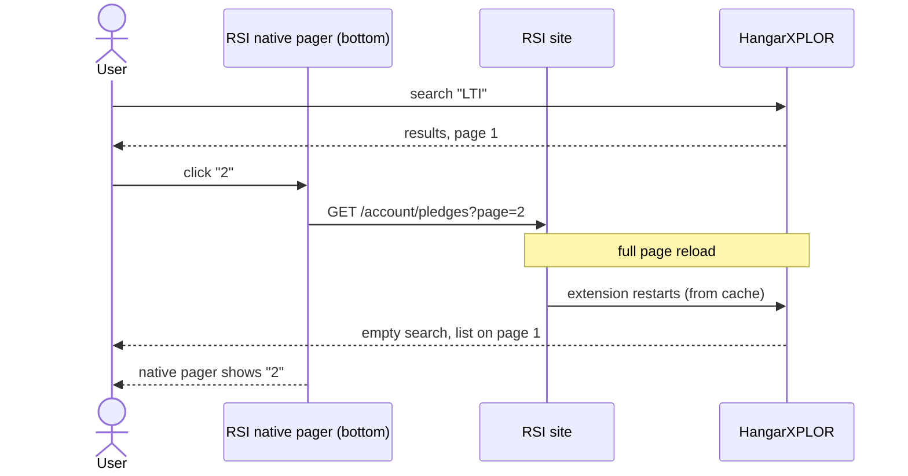
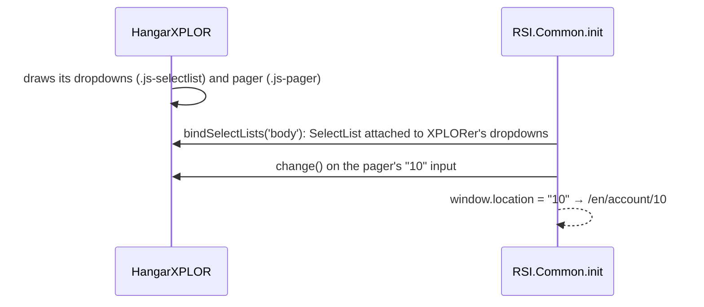
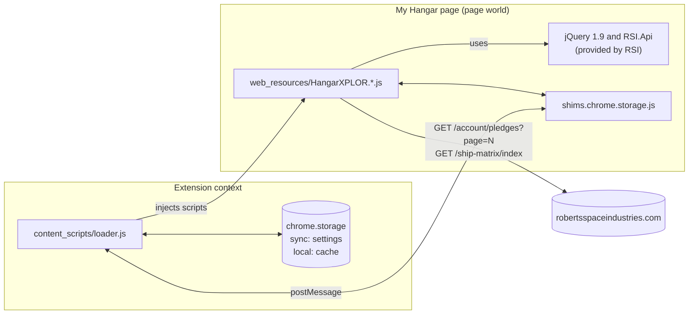
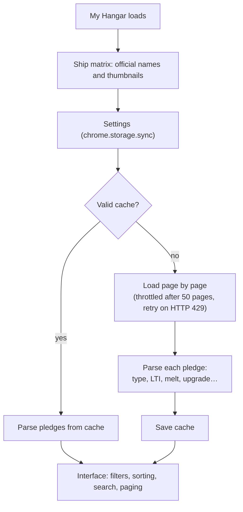

# HangarXPLOR — fixed edition

🇫🇷 [Version française](README.fr.md)

> A browser extension that upgrades the **My Hangar** page on [robertsspaceindustries.com](https://robertsspaceindustries.com/account/pledges): the whole hangar loaded at once, advanced filters, fuzzy search, melt values and exports.
>
> This repository is a fork of [dolkensp/HangarXPLOR](https://github.com/dolkensp/HangarXPLOR), whose author hasn't published anything since April 2026. It:
> - fixes what recent RSI site changes broke: paging, dropdowns, ship identification and item categories;
> - picks up two contributions still waiting upstream: the **buyback page** and the **CCU export**;
> - adds a **Coupons** filter.

> [!NOTE]
> **Stop-gap edition.** This fork is not meant to replace the original project. Every fix is proposed upstream (see [Contributing upstream](#contributing-upstream)). Once they are merged and released, switch back to the official extension.


<sub>Screenshots taken with the repository's test bench and made-up pledges: RSI's real CSS and scripts, no real account.</sub>

---

## Contents

- [Features](#features)
- [What this edition fixes](#what-this-edition-fixes)
- [What this edition adds](#what-this-edition-adds)
- [Installation](#installation)
- [Usage](#usage)
- [How it works](#how-it-works)
- [Test bench](#test-bench)
- [Repository layout](#repository-layout)
- [Contributing upstream](#contributing-upstream)
- [Credits and license](#credits-and-license)

---

## Features

| | Feature | Details |
|---|---|---|
| ⚡ | **Whole hangar at once** | Every page of the hangar is loaded in the background, then shown and sorted together. |
| 🔎 | **Fuzzy search** | Tolerates typos (Fuse.js). A suggestion appears; **Tab** completes it. |
| 🗂️ | **Type filter** | Ships, game packages, combos, paints, components, equipment, upgrades, **coupons**, decorations, selection. Items RSI leaves without a type (armor pieces, paints in packs…) are classified from their name. |
| 🏷️ | **Quick filters** | LTI, Warbond, Giftable, Meltable, Upgraded, Valuable, Reward, Free CCUs. |
| ↕️ | **Sorting** | By pledge date, name or value. |
| 📄 | **Paging** | 10, 20, 50, 100 or the whole hangar per page, with a pager above **and below** the list. |
| 💲 | **Values** | Melt value and base pledge under each item. A floating panel shows total spend and the value of the selection. |
| ✈️ | **Fixed names and thumbnails** | CCU'd ships show their real name and the image of the ship you now own, from the official ship matrix. Other pledges keep RSI's image, paint included. |
| 💾 | **Cache** | The hangar is cached in the browser, so later visits load instantly. |
| 📤 | **Exports** | Ships (`shiplist.csv` / `.json`, in [Hangar Transfer Format](https://docs.starcitizen.fans/)) and CCUs (`upgradelist.csv` / `.json`), for other tools. |
| ♻️ | **Buyback page** | The same interface on the buy-back pledges page: everything loaded at once, filters, sorting, search, counters, exports. |

---

## What this edition fixes

The original code worked, but **RSI changed its hangar page** and several things broke. Each fix below was **checked against a real 531-pledge hangar** (read-only), then reproduced and tested on the [test bench](#test-bench). All of them are proposed upstream (see [Contributing upstream](#contributing-upstream)).

### 1. Page 2 showed page 1 again and the search was lost

**Symptom:** with a search active, clicking "2" reloaded the whole page. The search was cleared and the list showed the first pledges, yet the pager said "2".

**Cause:** RSI now renders **two native pagers**, one above and one below the list, and dropped the `js-pager` class the extension used to remove them. The top one disappeared anyway, because its area is replaced by XPLORer's controls. The bottom one stayed, and its links reload the page.



**Fix:** native pagers are also removed by location, and an **XPLORer pager** replaces the bottom one. It stays in sync with the top one and scrolls back up to the list after a page change.

| XPLORer pager below the list | Result: page 2 of the search, no reload |
|---|---|
|  |  |

### 2. Dropdowns closing instantly, redirects to an error page

**Symptom** (upstream issue [#132](https://github.com/dolkensp/HangarXPLOR/issues/132)): a dropdown opens and closes immediately. Less often, the page goes to `/en/account/10`, an error page. It comes and goes from one load to the next.

**Cause:** when the page starts, the site's own script (`RSI.Common.init`):
- attaches its own `SelectList` widget to **every** `.js-selectlist` on the page, so dropdowns get toggled twice;
- navigates to the value of any `<input>` changed inside a `.js-pager`, which turns the "10 per page" choice into `/en/account/10`.

XPLORer's controls reused these classes. When the extension draws its interface **before** that init runs, which often happens when the hangar comes from cache, RSI hijacks it.



**Fix:** XPLORer's controls no longer use `js-selectlist` or `js-pager`. Those classes only serve as hooks for RSI's scripts; none of the extension's styles depend on them.

### 3. Ships "unidentified" or mistaken for their base version

**Symptom** (about fifteen upstream issues, including [#118](https://github.com/dolkensp/HangarXPLOR/issues/118), [#124](https://github.com/dolkensp/HangarXPLOR/issues/124), [#137](https://github.com/dolkensp/HangarXPLOR/issues/137), [#150](https://github.com/dolkensp/HangarXPLOR/issues/150)): in exports, some ships come out as "*Please report this ship to the plugin developers*". On Firefox, Sabre Raven becomes Sabre, a Mk II becomes a Mk I, Golem OX becomes Golem…

**Causes:**
- **Inconsistent sort.** The extension sorts the official ship list from longest to shortest name, so "Sabre Raven" is tried before "Sabre". But its comparator returned "equal" in some cases, so the order depended on the browser's sort algorithm. Chrome and Opera got it right by luck; on Firefox, 44 ships matched their base version.
- **Stale export table.** 23 recent ships were missing (Constellation Mk V Centaurus, M80, Pitbull, Starlite, Odin…). 7 more could never be found, because their name carries a trailing space in RSI's data (Lynx, Nautilus, C8X Pisces Expedition…).
- **Name variants.** "Mk I" was found inside "Mk II", and titles such as "A.T.L.S." or "Dragonfly Star Kitten Edition" matched nothing.

**Fixes:**
- a stable longest-first sort;
- whole-word matching that ignores punctuation;
- a table regenerated with `scripts/refresh-ship-codes.js` (321 entries);
- a second try without dots and without an "Edition" suffix.

**Result:** the 44 ships of the test hangar and 23 of the 24 names reported in the issues are identified, the same way whatever the sort order. The last one, "Heartseeker Mk II", doesn't exist in RSI's data.

### 4. Uncategorized items missing from filters

**Symptom** ([#116](https://github.com/dolkensp/HangarXPLOR/issues/116), [#80](https://github.com/dolkensp/HangarXPLOR/issues/80)): armor sets, suits or paint packs don't appear under any filter (Equipment, Paints…).

**Causes:**
- RSI lists many items with **no type at all**: armor pieces, paints in packs, hangars, decorations. 58 pledges of the test hangar were made only of such items.
- The Equipment, Components and Decorations filters only kept pledges holding **a single** item of that type.

**Fixes:**
- When RSI gives no type, it is inferred from the item name:
  - *Helmet, Core, Undersuit…* → equipment;
  - *Paint, Livery* → paint;
  - *… Hangar* → hangar;
  - *Model, Poster, Coin…* → decoration;
  - *Repeater, Cannon…* → component.
- The filters now include multi-item packs.

### 5. Thumbnails, titles and small defects

- **Paint thumbnails replaced by the generic image** ([#110](https://github.com/dolkensp/HangarXPLOR/issues/110), [#99](https://github.com/dolkensp/HangarXPLOR/issues/99)): RSI's image often shows the ship with its paint. It is now replaced only for CCU'd pledges, whose image still shows the original ship.
- **Elements wiped from titles** ([#147](https://github.com/dolkensp/HangarXPLOR/issues/147)): when renaming a pledge, the extension erased what RSI puts in the title, such as the "Upgrades" button (CCU history) or game access tags. Only the text is replaced now.
- Decorations were relabelled "Hangar" instead of "Hangar decoration".
- A single pledge with unexpected HTML stopped the whole load. It is now skipped, with a console warning.
- "*Your hangar is empty*" was shown when the filters left nothing. The message is now "*No items match the current filters.*".
- Changing the search, the type or a quick filter goes back to page 1.

---

## What this edition adds

### Coupons filter

Subscriber reward coupons (*Centurion 10%*, *Imperator 20%*…) were already recognized, but no filter showed them.

| Type menu with "Coupons" | "Coupons" filter applied |
|---|---|
|  |  |

### Buyback page

Picks up pull request [#139](https://github.com/dolkensp/HangarXPLOR/pull/139) by Drew Short, still waiting upstream. The **buy-back pledges** page gets the same interface as the hangar: everything loaded at once, with type filters, sorting, search, counters and CSV/JSON exports.


Checked against RSI's real markup, the original PR had several issues, fixed here:
- RSI ignores the requested page size (`pagesize=50`) and the PR stopped after the first page. On the test bench it loaded 10 pledges out of 14.
- The date was always empty, because RSI now labels it "*Reclaim Date*".
- The "*No pledges available*" line of an empty page was counted as a pledge.
- Some counters turned into "NaN".
- Its pager brought back the `js-pager` class that RSI hijacks (see fix 2).
- Its cache stayed stale for the rest of the day after a buy-back.
- `src/manifest.json` wasn't updated: loaded from `src`, the extension couldn't find its new scripts.

### CCU export

Picks up pull request [#144](https://github.com/dolkensp/HangarXPLOR/pull/144) by Myles Berueda. Two buttons, **CCUs CSV** and **CCUs JSON**, export upgrades (from ship, to ship, price, date…), next to **Ships CSV** and **Ships JSON**. The labels were shortened so the floating panel stays as narrow as before.

---

## Installation

The extension isn't published on a store: you load it in **developer mode**. It works in Chromium-based browsers (Opera, Opera GX, Chrome, Edge, Brave).

> [!IMPORTANT]
> First disable the official "Star Citizen Hangar XPLORer" if you have it installed. Otherwise both versions run on the page at the same time.

1. Get the repository:
   ```bash
   git clone https://github.com/Sckriva/HangarXPLOR.git
   ```
   Or, without git: **Code → Download ZIP** on the GitHub page, then unzip it.
2. Open the extensions page:
   | Browser | Address |
   |---|---|
   | Opera / Opera GX | `opera://extensions` |
   | Chrome / Brave | `chrome://extensions` |
   | Edge | `edge://extensions` |
3. Turn on **Developer mode**.
4. Click **Load unpacked** and pick the repository's **`src`** folder.
5. Open [My Hangar](https://robertsspaceindustries.com/account/pledges) or [Buy Back Pledges](https://robertsspaceindustries.com/account/buy-back-pledges). The first load walks through every page (allow a few seconds per RSI page); later visits come from the cache.

**Updating:** `git pull`, then click **Reload** (↻) on the extension's card.

> [!NOTE]
> An extension loaded this way doesn't update itself. Its settings and cache belong to this install and start from scratch compared with the store version.

<details>
<summary><b>Building per-browser packages (optional)</b></summary>

The original build script creates one `.zip` per browser in `dist/`:

```bash
npm install
node build.js 3.17.192
```

See [docs/build.md](docs/build.md) for Firefox, Safari and CI.
</details>

---

## Usage

| Control | How to use it |
|---|---|
| **Type menu** | Narrows the list to one category: *All Ships*, *Upgrades*, *Coupons*… |
| **Sort menu** | *Pledge Date* (newest first), *Pledge Name*, *Pledge Value*. |
| **Quick filters** | Three states per click: neutral → **only** (lit) → **exclude** → neutral. *Free CCUs* excludes $0 upgrades by default. |
| **Search** | Type a few letters. Press **Tab** to accept the greyed-out suggestion. |
| **Paging** | Items per page in the menu; page numbers above and below the list. |
| **Selection** | Click a pledge to select it. The floating panel shows the selected total, and the *Selected* type shows only the selection. |
| **Floating panel** | Click it to switch between amounts (USD) and counts (CCUs, ships, packages). |
| **Exports** | *Ships CSV* / *Ships JSON* (ships, Hangar Transfer Format) and *CCUs CSV* / *CCUs JSON* (upgrades). If pledges are selected, only the selection is exported. |
| **Buyback page** | Same principles: type menu, sorting (*Recent First*…), search, items per page, per-category counters and exports in the floating panel. |

**Extension popup** (toolbar icon):

| Setting | Effect |
|---|---|
| Hide Pledge ID | Hides the `(123456)` number at the end of names. |
| Hide Pledge Prefix | Hides the type prefix (`ship - `, `upgrade - `…). |
| Hide Nicknames | Shows the ship's name instead of the nickname you gave it. |
| Show Hangar Value | Floating panel in amounts rather than counts. |
| Clear Cache | Forces a full reload of the hangar from RSI. |

---

## How it works

The extension injects its scripts **into the RSI page itself**, to reuse the page's jQuery and API. Those scripts can't reach the browser's extension APIs, so a small `postMessage` bridge relays storage.



**Load cycle:**



The original author's detailed documentation: [architecture](docs/architecture.md), [file reference](docs/file-reference.md), [build](docs/build.md).

---

## Test bench

`tools/harness/` reproduces the **My Hangar** and **Buy Back Pledges** pages locally, with no RSI account and without touching a real hangar. It uses **RSI's real scripts and CSS**, with made-up pledges modelled on RSI's real markup (October 2026):
- LTI ships, and a CCU'd ship with its "Upgrades" button;
- ships with a paint image;
- CCUs and packs whose items have no type;
- decorations and coupons;
- a paginated buyback page.

This bench is where the fixes above were reproduced and tested, and where this README's screenshots were taken.

```bash
python tools/harness/fetch_rsi.py      # once: downloads RSI's public files into tools/harness/rsi/
python tools/harness/server.py 8791    # starts the fake hangar page
```

Then open <http://localhost:8791/en/account/pledges?page=1> or <http://localhost:8791/en/account/buy-back-pledges?page=1>.

| URL parameter | Effect |
|---|---|
| `ext=src` | Extension folder to inject, relative to the repository root (`src` by default). Remembered in a cookie, so native pager links keep it. |
| `style=plain` | Without RSI's CSS: faster, and readable offline. |
| `page=N` | RSI page requested: 5 made-up pages of 10 pledges for the hangar, 2 pages for the buyback page. |

> [!NOTE]
> RSI's files are **not** versioned (`tools/harness/rsi/` is git-ignored). The `rsi.core` and `rsi.account` bundle names carry a build number. If RSI changes it, `fetch_rsi.py` explains how to pass the new addresses.

To compare with another version, check it out into a folder of the repository with `git worktree add .wt-release release`, then open `?ext=.wt-release/src`.

`POST /capture?name=X` saves the request body to `tools/harness/private/X.html`, a git-ignored folder, to turn a real page into test data. Browsers may block requests from a public site to `localhost`, though (local network protection).

---

## Repository layout

```text
.
├── src/                      The extension (folder to load in the browser)
│   ├── manifest.json         Complete MV3 manifest
│   ├── content_scripts/      loader.js: script injection and storage bridge
│   ├── web_resources/        Interface code (HangarXPLOR.*.js, CSS, Fuse.js, ship-codes.json)
│   ├── ui_resources/         Settings popup
│   └── manifest.*.json       Per-browser fragments, used by build.js
├── tools/harness/            Local test bench (fake My Hangar and buyback pages)
├── scripts/                  refresh-ship-codes.js: regenerates ship-codes.json from RSI's ship matrix
├── docs/                     Technical documentation and screenshots (docs/img/)
├── build.js                  Per-browser package build
├── README.md                 This page (English)
└── README.fr.md              French version
```

| Branch | Purpose |
|---|---|
| **`main`** | Working branch: original code, fixes, PRs #139 and #144, Coupons filter, test bench. |
| `release` | Exact copy of the upstream `release` branch, never modified here. |
| `fix/pager-reload-and-rsi-widgets`, `fix/ship-identification`, `fix/kindless-items-thumbnails-titles`, `feature/coupons-filter` | Each fix on its own, based on `release`, as proposed upstream (#148, #151, #152, #153). |
| `archive/v1` | Older upstream version (Manifest V2). |

**Getting upstream changes** (remote `origin` = `dolkensp/HangarXPLOR`):

```bash
git fetch origin
git switch release && git merge --ff-only origin/release
git switch main && git merge release
```

**Updating the ship list** when RSI releases new ships: `node scripts/refresh-ship-codes.js`, then commit `src/web_resources/ship-codes.json`.

---

## Contributing upstream

The goal is for these fixes to go back into the original project. They are proposed as short, independent pull requests that can be merged one at a time, in any order:

| Pull request | Content | Fixes in this README |
|---|---|---|
| [#148](https://github.com/dolkensp/HangarXPLOR/pull/148) | Bottom pager reloading the page, dropdowns hijacked by RSI | 1 and 2 |
| [#151](https://github.com/dolkensp/HangarXPLOR/pull/151) | Ship identification, regenerated export table | 3 |
| [#152](https://github.com/dolkensp/HangarXPLOR/pull/152) | Untyped items, filters, thumbnails, title elements | 4 and 5 |
| [#153](https://github.com/dolkensp/HangarXPLOR/pull/153) | Coupons filter | addition |

The buyback page fixes were offered to Drew Short, author of PR [#139](https://github.com/dolkensp/HangarXPLOR/pull/139), in a comment on it, so he can fold them into his work. The CCU export ([#144](https://github.com/dolkensp/HangarXPLOR/pull/144)) needs no changes.

Only the test bench is specific to this edition.

A review of the open upstream PRs set aside a few:
- [#145](https://github.com/dolkensp/HangarXPLOR/pull/145) ("trusted sites") would send the hangar's content to third-party sites and ask for permission on every site.
- The oldest ones (#71, #73, #77, #103) are obsolete or conflict entirely with the current code.

---

## Credits and license

- **HangarXPLOR**: © 2015 Peter Dolkens ([/u/alluran](https://www.reddit.com/user/alluran)) and contributors, [dolkensp/HangarXPLOR](https://github.com/dolkensp/HangarXPLOR).
- **Buyback page**: Drew Short ([PR #139](https://github.com/dolkensp/HangarXPLOR/pull/139)). **CCU export**: Myles Berueda ([PR #144](https://github.com/dolkensp/HangarXPLOR/pull/144)).
- **This edition**: compatibility fixes, integration and fixes of PRs #139 and #144, Coupons filter and test bench, by Sckriva.
- Released under the **MIT license**: see [LICENSE](LICENSE).

*Star Citizen®, Roberts Space Industries® and Cloud Imperium® are trademarks of Cloud Imperium Rights LLC. This fan project is not affiliated with or endorsed by Cloud Imperium Games.*
