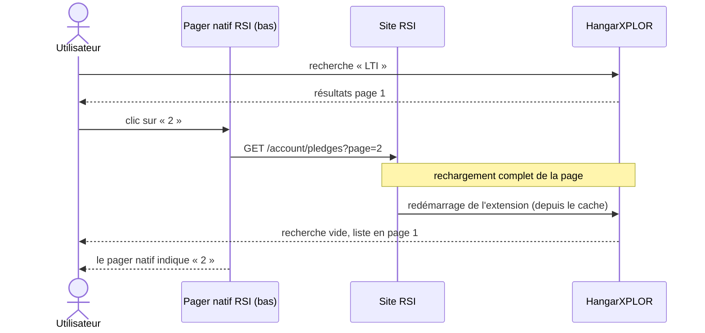
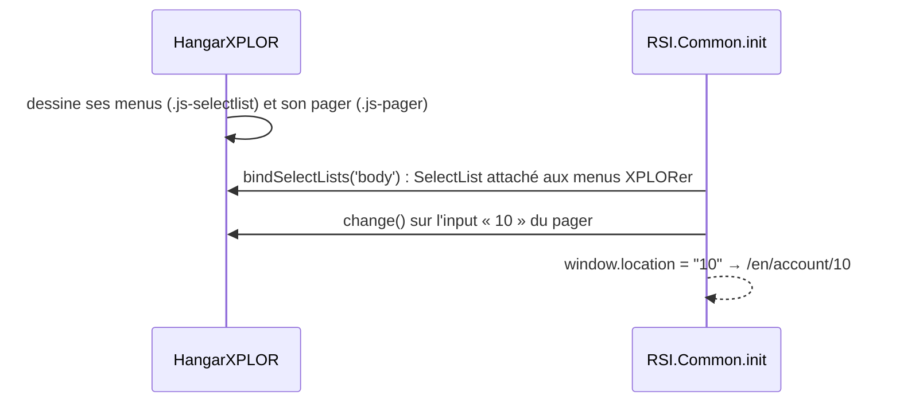
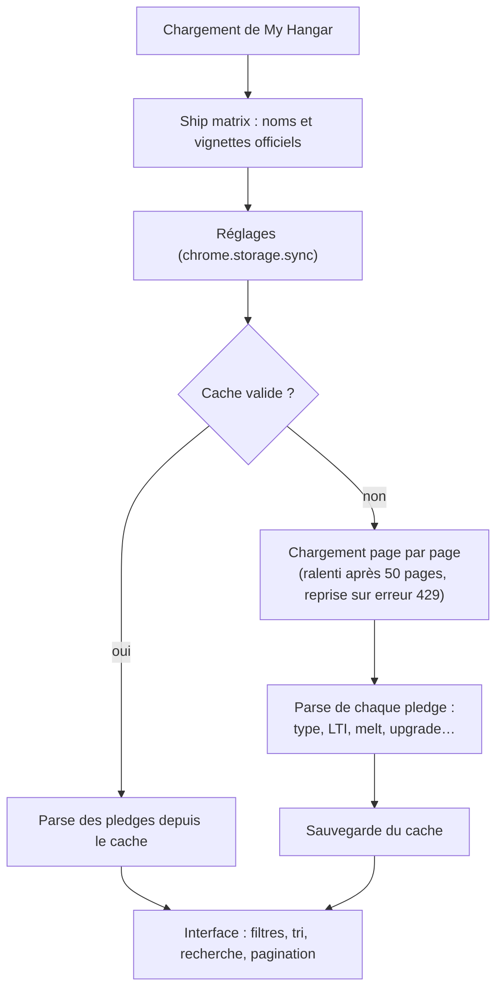

# HangarXPLOR — édition corrigée

> Extension de navigateur qui transforme la page **My Hangar** de [robertsspaceindustries.com](https://robertsspaceindustries.com/account/pledges) : tout le hangar chargé d'un coup, filtres avancés, recherche floue, valeurs de melt et exports.
> Ce dépôt est un fork maintenu de [dolkensp/HangarXPLOR](https://github.com/dolkensp/HangarXPLOR). Il corrige la pagination cassée par les derniers changements du site RSI et ajoute un filtre **Coupons**.


<sub>Captures réalisées avec le banc de test du dépôt et des données factices : vrai CSS et vrais scripts RSI, aucun compte réel.</sub>

---

## Sommaire

- [Fonctionnalités](#fonctionnalités)
- [Ce que cette édition corrige](#ce-que-cette-édition-corrige)
- [Installation](#installation)
- [Utilisation](#utilisation)
- [Fonctionnement technique](#fonctionnement-technique)
- [Banc de test](#banc-de-test)
- [Organisation du dépôt](#organisation-du-dépôt)
- [Contribution au projet d'origine](#contribution-au-projet-dorigine)
- [Crédits et licence](#crédits-et-licence)

---

## Fonctionnalités

| | Fonctionnalité | Détail |
|---|---|---|
| ⚡ | **Hangar complet en une fois** | Toutes les pages du hangar sont chargées en arrière-plan, puis affichées et triées ensemble. |
| 🔎 | **Recherche floue** | Tolère les fautes de frappe (Fuse.js). Une suggestion s'affiche, **Tab** la complète. |
| 🗂️ | **Filtre par type** | Vaisseaux, packs de jeu, combos, peintures, composants, équipement, upgrades, **coupons**, décorations, sélection. |
| 🏷️ | **Filtres rapides** | LTI, Warbond, Giftable, Meltable, Upgraded, Valuable, Reward, Free CCUs. |
| ↕️ | **Tri** | Par date d'achat, par nom ou par valeur. |
| 📄 | **Pagination** | 10, 20, 50, 100 ou tout le hangar par page, avec un pager en haut **et en bas** de la liste. |
| 💲 | **Valeurs** | Valeur de melt et pledge d'origine sous chaque élément. Panneau flottant avec la dépense totale et le total de la sélection. |
| ✈️ | **Noms et vignettes corrigés** | Les vaisseaux upgradés (CCU) affichent leur vrai nom et la bonne image, tirés du *ship matrix* officiel. |
| 💾 | **Cache** | Le hangar est mis en cache dans le navigateur : les visites suivantes s'affichent instantanément. |
| 📤 | **Exports** | `shiplist.csv` et `shiplist.json` au format [Hangar Transfer Format](https://docs.starcitizen.fans/), pour d'autres outils. |

---

## Ce que cette édition corrige

Le code d'origine fonctionnait, mais **RSI a modifié sa page Hangar** et deux comportements se sont cassés. Les deux sont corrigés ici et proposés à l'auteur d'origine (voir [Contribution](#contribution-au-projet-dorigine)).

### 1. La page 2 réaffichait la page 1 et la recherche disparaissait

**Symptôme :** avec une recherche active, cliquer sur « 2 » rechargeait toute la page. La recherche était vidée, la liste affichait les premiers pledges, et le pager indiquait pourtant « 2 ».

**Cause :** RSI affiche désormais **deux pagers natifs**, un au-dessus et un sous la liste, et leur a retiré la classe `js-pager` que l'extension utilisait pour les supprimer. Celui du haut disparaissait quand même, parce que sa zone est remplacée par les contrôles XPLORer. Celui du bas restait en place, et ses liens rechargent la page.



**Correctif :** les pagers natifs sont aussi supprimés selon leur emplacement, et un **pager XPLORer** les remplace sous la liste. Il reste synchronisé avec celui du haut et remonte en haut de la liste après un changement de page.

| Pager XPLORer sous la liste | Résultat : page 2 de la recherche, sans rechargement |
|---|---|
|  |  |

### 2. Menus qui se referment aussitôt, redirection vers une page d'erreur

**Symptôme** (ticket [#132](https://github.com/dolkensp/HangarXPLOR/issues/132) chez l'auteur d'origine) : un menu déroulant s'ouvre puis se referme immédiatement. Plus rarement, la page part vers `/en/account/10`, une page d'erreur. Le problème va et vient d'un chargement à l'autre.

**Cause :** au démarrage, le script du site (`RSI.Common.init`) :
- attache son propre widget `SelectList` à **tous** les éléments `.js-selectlist` de la page, donc les menus sont basculés deux fois ;
- redirige vers la valeur de tout `<input>` modifié dans un `.js-pager`, ce qui transforme le choix « 10 per page » en `/en/account/10`.

Les contrôles XPLORer réutilisaient ces classes. Si l'interface de l'extension est dessinée **avant** cette initialisation, ce qui arrive souvent quand le hangar vient du cache, RSI la capture.



**Correctif :** les contrôles XPLORer n'utilisent plus `js-selectlist` ni `js-pager`. Ces classes ne servent qu'aux scripts RSI, aucun style de l'extension n'en dépend.

### 3. Petites améliorations

- **Filtre « Coupons »** : les coupons de récompense d'abonnement (*Centurion 10 %*, *Imperator 20 %*…) étaient déjà reconnus, mais aucun filtre ne les affichait.
- **Retour en page 1** quand la recherche, le type ou un filtre rapide change : on ne se retrouve plus en page 3 d'une liste qui n'en a qu'une.

| Menu des types avec « Coupons » | Filtre « Coupons » appliqué |
|---|---|
|  |  |

---

## Installation

L'extension n'est pas publiée sur un store : on la charge en **mode développeur**. Elle fonctionne dans les navigateurs basés sur Chromium (Opera, Opera GX, Chrome, Edge, Brave).

> [!IMPORTANT]
> Désactivez d'abord la version officielle « Star Citizen Hangar XPLORer » si elle est installée. Sinon, les deux versions s'exécutent en même temps sur la page.

1. Récupérez le dépôt :
   ```bash
   git clone http://hildarian:3000/Sckriva/hangarxplor.git
   ```
2. Ouvrez la page des extensions :
   | Navigateur | Adresse |
   |---|---|
   | Opera / Opera GX | `opera://extensions` |
   | Chrome / Brave | `chrome://extensions` |
   | Edge | `edge://extensions` |
3. Activez le **Mode développeur**.
4. Cliquez sur **Charger l'extension non empaquetée** et choisissez le dossier **`src`** du dépôt.
5. Ouvrez [My Hangar](https://robertsspaceindustries.com/account/pledges). Le premier chargement parcourt tout le hangar (comptez quelques secondes par page RSI), les suivants sortent du cache.

**Mise à jour :** `git pull`, puis cliquez sur **Recharger** (↻) sur la carte de l'extension.

> [!NOTE]
> Une extension chargée de cette façon ne se met pas à jour toute seule. Ses réglages et son cache sont propres à cette installation et repartent de zéro par rapport à la version du store.

<details>
<summary><b>Construire les archives par navigateur (optionnel)</b></summary>

Le script d'origine produit un `.zip` par navigateur dans `dist/` :

```bash
npm install
node build.js 3.17.192
```

Voir [docs/build.md](docs/build.md) pour Firefox, Safari et la CI.
</details>

---

## Utilisation

| Élément | Comment s'en servir |
|---|---|
| **Menu des types** | Restreint la liste à une catégorie : *All Ships*, *Upgrades*, *Coupons*… |
| **Menu de tri** | *Pledge Date* (le plus récent d'abord), *Pledge Name*, *Pledge Value*. |
| **Filtres rapides** | Trois états par clic : neutre → **inclure uniquement** (allumé) → **exclure** → neutre. *Free CCUs* exclut par défaut les upgrades à 0 $. |
| **Recherche** | Tapez quelques lettres. La suggestion grisée se complète avec **Tab**. |
| **Pagination** | Nombre d'éléments par page dans le menu ; numéros de page en haut et en bas de la liste. |
| **Sélection** | Cliquez sur un pledge pour le sélectionner. Le panneau flottant affiche le total sélectionné, et le type *Selected* n'affiche que la sélection. |
| **Panneau flottant** | Cliquez dessus pour basculer entre les montants (USD) et les compteurs (CCU, vaisseaux, packs). |
| **Exports** | *Download CSV* et *Download JSON* (format Hangar Transfer Format). |

**Popup de l'extension** (icône dans la barre d'outils) :

| Réglage | Effet |
|---|---|
| Hide Pledge ID | Masque le numéro `(123456)` en fin de nom. |
| Hide Pledge Prefix | Masque le préfixe de type (`ship - `, `upgrade - `…). |
| Hide Nicknames | Affiche le nom du vaisseau plutôt que le surnom que vous lui avez donné. |
| Show Hangar Value | Panneau flottant en montants plutôt qu'en compteurs. |
| Clear Cache | Force un rechargement complet du hangar depuis RSI. |

---

## Fonctionnement technique

L'extension injecte ses scripts **dans la page RSI elle-même**, pour réutiliser son jQuery et son API. Ces scripts n'ont pas accès aux API du navigateur, donc un petit pont `postMessage` relaie le stockage.


**Cycle de chargement :**



Documentation détaillée de l'auteur d'origine, en anglais : [architecture](docs/architecture.md), [référence des fichiers](docs/file-reference.md), [construction](docs/build.md).

---

## Banc de test

`tools/harness/` reproduit la page **My Hangar** en local, sans compte RSI et sans toucher au vrai hangar. Elle utilise **les vrais scripts et le vrai CSS de RSI** et des pledges factices : vaisseaux, LTI, upgrades, peintures, décorations, coupons. C'est avec ce banc qu'ont été reproduits les deux bugs ci-dessus, et réalisées les captures de ce README.

```bash
python tools/harness/fetch_rsi.py      # une fois : télécharge les fichiers publics de RSI dans tools/harness/rsi/
python tools/harness/server.py 8791    # démarre la fausse page Hangar
```

Ouvrez ensuite <http://localhost:8791/en/account/pledges?page=1>.

| Paramètre d'URL | Effet |
|---|---|
| `ext=src` | Dossier de l'extension à injecter, relatif à la racine du dépôt (`src` par défaut). Mémorisé par cookie, donc les liens des pagers natifs le gardent. |
| `style=plain` | Sans le CSS de RSI : plus rapide, lisible hors ligne. |
| `page=N` | Page RSI demandée (5 pages factices de 10 pledges). |

> [!NOTE]
> Les fichiers de RSI ne sont **pas** versionnés (`tools/harness/rsi/` est ignoré par git). Les noms des bundles `rsi.core` et `rsi.account` contiennent un numéro de build. Si RSI le change, `fetch_rsi.py` explique comment lui passer les nouvelles adresses.

Pour tester deux versions côte à côte, extrayez l'autre version dans un dossier du dépôt (par exemple `git worktree add old release`), puis ouvrez `?ext=old/src`.

---

## Organisation du dépôt

```text
.
├── src/                      Extension (dossier à charger dans le navigateur)
│   ├── manifest.json         Manifeste MV3 complet
│   ├── content_scripts/      loader.js : injection des scripts et pont de stockage
│   ├── web_resources/        Code de l'interface (HangarXPLOR.*.js, CSS, Fuse.js, ship-codes.json)
│   ├── ui_resources/         Popup de réglages
│   └── manifest.*.json       Fragments par navigateur, utilisés par build.js
├── tools/harness/            Banc de test local (fausse page My Hangar)
├── docs/                     Documentation technique et captures (docs/img/)
├── build.js                  Construction des archives par navigateur
└── README.md
```

| Branche | Rôle |
|---|---|
| **`main`** | Branche de travail : code d'origine + correctifs + filtre Coupons + banc de test. |
| `release` | Copie exacte de la branche `release` de l'auteur d'origine, jamais modifiée ici. |
| `fix/pager-reload-and-rsi-widgets` | Correctif seul, tel que proposé à l'auteur d'origine. |
| `archive/v1` | Ancienne version (Manifest V2) de l'auteur d'origine. |

**Récupérer les nouveautés de l'auteur d'origine** (remote `origin` = `dolkensp/HangarXPLOR`) :

```bash
git fetch origin
git switch release && git merge --ff-only origin/release && git push gitea release
git switch main && git merge release
```

---

## Contribution au projet d'origine

Les correctifs 1 et 2 sont proposés à l'auteur dans la pull request **[dolkensp/HangarXPLOR#148](https://github.com/dolkensp/HangarXPLOR/pull/148)**, branche `fix/pager-reload-and-rsi-widgets`. Si elle est acceptée et publiée sur les stores, la version officielle redevient utilisable. Le filtre Coupons et le banc de test restent propres à cette édition.

---

## Crédits et licence

- **HangarXPLOR** : © 2015 Peter Dolkens ([/u/alluran](https://www.reddit.com/user/alluran)) et contributeurs, [dolkensp/HangarXPLOR](https://github.com/dolkensp/HangarXPLOR).
- **Cette édition** : correctifs de compatibilité, filtre Coupons et banc de test, par Sckriva.
- Distribué sous **licence MIT** : voir [LICENSE](LICENSE).

*Star Citizen®, Roberts Space Industries® et Cloud Imperium® sont des marques de Cloud Imperium Rights LLC. Ce projet de fan n'est ni affilié à Cloud Imperium Games ni approuvé par cette société.*
